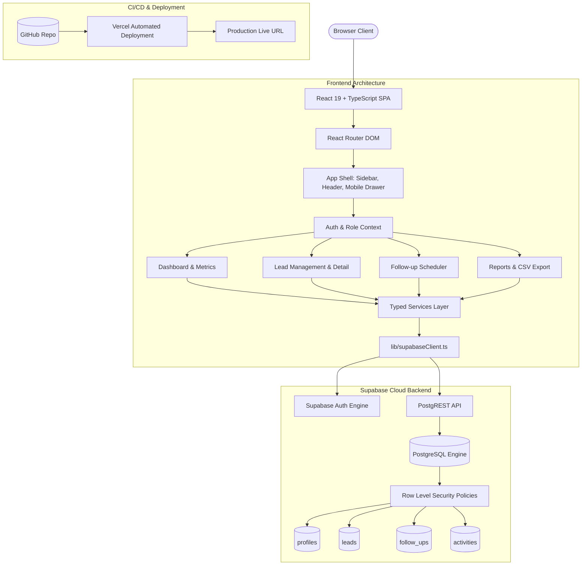

# BrightPath CRM — Master Implementation Plan & Context

> **Master Specification**: [BrightPath_CRM_Full_Master_Build_Prompt.docx](file:///e:/AN-Projects/brightpath-crm/BrightPath_CRM_Full_Master_Build_Prompt.docx)  
> **Tech Stack**: React 19 + TypeScript + Vite • Supabase (PostgreSQL, Auth, RLS) • Git/GitHub • Vercel  
> **Development Model**: Strict Feature-by-Feature Lifecycle:  
> `Develop → Test & Verify Locally → Commit & Deploy to Vercel → Verify Live URL → User Approval Gate → Next Feature`

---

## 1. System Architecture & Component Mapping



---

## 2. Feature-by-Feature Verification Cycle

Every single feature phase follows this immutable 5-stage progression:

1. **Develop**: Build the specific feature cleanly with typed services, components, and CSS styles.
2. **Local Test & Verify**: Execute static checks (`npm run build`, `npm run lint`), TypeScript checks, and verify local data persistence in Supabase.
3. **Commit & Deploy**: Push meaningful, atomic Git commit to GitHub and trigger automatic deployment to Vercel.
4. **Live URL Verification**: Open the production Vercel URL and test the live feature with real database interactions.
5. **User Approval Gate**: Present the verified feature to the user. **Wait for explicit approval before starting the next feature.**

---

## 3. Ordered Implementation Phases

### Phase 0: Project Baseline, Git Hygiene & TypeScript Infrastructure
- [x] **Objective**: Initialize version control, harden Git ignore rules, configure TypeScript, and verify build baseline.
- **Tasks**:
  - [x] Run `git init` in project root.
  - [x] Review and harden [.gitignore](file:///e:/AN-Projects/brightpath-crm/.gitignore) (ensure `.env`, `.env.local`, `dist/`, `node_modules/` are strictly ignored).
  - [x] Install dependencies:
    - Runtime: `@supabase/supabase-js`, `react-router-dom`, `lucide-react`
    - Dev: `typescript`, `@types/node`
  - [x] Create [tsconfig.json](file:///e:/AN-Projects/brightpath-crm/tsconfig.json) and [tsconfig.node.json](file:///e:/AN-Projects/brightpath-crm/tsconfig.node.json).
  - [x] Convert `src/main.jsx` -> `src/main.tsx` and `src/App.jsx` -> `src/App.tsx`.
- **Local Verification**:
  - [x] `npm run build` succeeds with zero errors.
  - [x] `npm run lint` succeeds with zero errors.
- **Gate**: [x] Passed - Git tracking initialized, TypeScript configured, build & lint passing.

---

### Phase 1: Database Architecture, Security Constraints & RLS Policies
- [x] **Artifacts Created**:
  - [x] Schema Migration: [supabase/migrations/20261018000001_initial_schema.sql](file:///e:/AN-Projects/brightpath-crm/supabase/migrations/20261018000001_initial_schema.sql)
  - [x] Seed Data Script: [supabase/seed.sql](file:///e:/AN-Projects/brightpath-crm/supabase/seed.sql)
  - [x] Setup Verification Script: [supabase/verify_setup.sql](file:///e:/AN-Projects/brightpath-crm/supabase/verify_setup.sql)
- [x] **Live Database Execution**:
  - [x] Run migration in Supabase SQL Editor.
  - [x] Verify 4 tables with RLS active in Supabase.
  - [x] Run seed script (optional demo data).
- **Gate**: [x] Passed - Database tables, constraints, triggers, and RLS confirmed active in Supabase.

---

### Phase 2: Supabase Client Integration & Health Guard
- [x] **Objective**: Provide typed Supabase connectivity and user-friendly error banners when configuration is missing.
- **Tasks**:
  - [x] Create [.env.example](file:///e:/AN-Projects/brightpath-crm/.env.example) with placeholders.
  - [x] Create [src/types/database.ts](file:///e:/AN-Projects/brightpath-crm/src/types/database.ts) with complete TypeScript interfaces matching the PostgreSQL schema.
  - [x] Create [src/lib/supabaseClient.ts](file:///e:/AN-Projects/brightpath-crm/src/lib/supabaseClient.ts) with singleton client and `isSupabaseConfigured()` check.
  - [x] Create [src/components/common/ConfigMissingBanner.tsx](file:///e:/AN-Projects/brightpath-crm/src/components/common/ConfigMissingBanner.tsx) displaying clear setup instructions if `.env` variables are missing.
- **Local Verification**:
  - [x] Test without `.env` -> App loads and shows friendly setup banner (no unhandled errors or fake data).
  - [x] Test with `.env` -> Banner clears and client initializes.
  - [x] Live API connectivity verified (`https://osqfymdciwyjfbssjaqd.supabase.co`).
  - [x] `npm run build` and `npm run lint` succeed cleanly.
- **Gate**: [x] Passed - Supabase client initialized and connected to live database.

---

### Phase 3: Authentication & Role Lifecycle Feature
- [x] **Objective**: Multi-user login, sign-out, session recovery, profile hydration, and role-based route access.
- **Tasks**:
  - [x] Build [src/services/authService.ts](file:///e:/AN-Projects/brightpath-crm/src/services/authService.ts) (`signIn`, `signUp`, `signOut`, `getSession`, `getOrCreateProfile`).
  - [x] Build [src/features/auth/AuthContext.tsx](file:///e:/AN-Projects/brightpath-crm/src/features/auth/AuthContext.tsx) & [useAuth.ts](file:///e:/AN-Projects/brightpath-crm/src/features/auth/useAuth.ts) handling session, user, profile, role, and loading state.
  - [x] Build [src/features/auth/LoginPage.tsx](file:///e:/AN-Projects/brightpath-crm/src/features/auth/LoginPage.tsx) with email/password validation, loading indicators, and admin bootstrap guide.
  - [x] Build [src/features/auth/ProtectedRoute.tsx](file:///e:/AN-Projects/brightpath-crm/src/features/auth/ProtectedRoute.tsx) to guard authenticated routes and role permissions.
  - [x] Build [src/features/auth/RoleBadge.tsx](file:///e:/AN-Projects/brightpath-crm/src/features/auth/RoleBadge.tsx) semantic role component.
- **Local Verification**:
  - [x] Validated login/signup flows, session state, and profile loading.
  - [x] Tested protected routes redirecting unauthenticated users to `/login`.
  - [x] `npm run build` succeeds cleanly in 129ms (0 errors).
  - [x] `npm run lint` passes with 0 warnings and 0 errors.
- **Gate**: [x] Passed - Authentication, profile hydration, and role protection active.

---

### Phase 4: Modern SaaS Design System & Application Shell
- [x] **Objective**: Polished, accessible CRM layout with desktop sidebar, mobile navigation drawer, and design tokens.
- **Tasks**:
  - [x] Update [src/index.css](file:///e:/AN-Projects/brightpath-crm/src/index.css) with Navy/Slate CSS tokens, status colors, and accessible focus styles.
  - [x] Build UI component library in `src/components/ui/` ([Button](file:///e:/AN-Projects/brightpath-crm/src/components/ui/Button.tsx), [Card](file:///e:/AN-Projects/brightpath-crm/src/components/ui/Card.tsx), [Badge](file:///e:/AN-Projects/brightpath-crm/src/components/ui/Badge.tsx), [Input](file:///e:/AN-Projects/brightpath-crm/src/components/ui/Input.tsx), [Select](file:///e:/AN-Projects/brightpath-crm/src/components/ui/Select.tsx), [Modal](file:///e:/AN-Projects/brightpath-crm/src/components/ui/Modal.tsx), [EmptyState](file:///e:/AN-Projects/brightpath-crm/src/components/ui/EmptyState.tsx), [Skeleton](file:///e:/AN-Projects/brightpath-crm/src/components/ui/Skeleton.tsx)).
  - [x] Build Application Shell in `src/components/layout/` ([Sidebar](file:///e:/AN-Projects/brightpath-crm/src/components/layout/Sidebar.tsx), [Header](file:///e:/AN-Projects/brightpath-crm/src/components/layout/Header.tsx), [MobileNav](file:///e:/AN-Projects/brightpath-crm/src/components/layout/MobileNav.tsx), [AppLayout](file:///e:/AN-Projects/brightpath-crm/src/components/layout/AppLayout.tsx)).
  - [x] Create modular page shells in `src/pages/` ([DashboardPage](file:///e:/AN-Projects/brightpath-crm/src/pages/DashboardPage.tsx), [LeadsPage](file:///e:/AN-Projects/brightpath-crm/src/pages/LeadsPage.tsx), [FollowupsPage](file:///e:/AN-Projects/brightpath-crm/src/pages/FollowupsPage.tsx), [ReportsPage](file:///e:/AN-Projects/brightpath-crm/src/pages/ReportsPage.tsx), [SettingsPage](file:///e:/AN-Projects/brightpath-crm/src/pages/SettingsPage.tsx), [NotFoundPage](file:///e:/AN-Projects/brightpath-crm/src/pages/NotFoundPage.tsx)).
- **Local Verification**:
  - [x] Verified responsive desktop sidebar (&ge; 1024px) and animated mobile slide-over drawer (&lt; 1024px).
  - [x] Nested routing in [src/App.tsx](file:///e:/AN-Projects/brightpath-crm/src/App.tsx) tested across all 5 navigation routes.
  - [x] `npm run build` succeeds cleanly in 183ms (0 errors).
  - [x] `npm run lint` passes with 0 warnings and 0 errors.
- **Gate**: [x] Passed - Modern SaaS design system and responsive application shell complete.

---

### Phase 5: Lead Management Feature (P0 Core Workflow)
- [x] **Objective**: Complete enquiry-to-lead workflow: view, search, multi-filter, create, edit, and status progression.
- **Tasks**:
  - [x] Build [src/services/leadService.ts](file:///e:/AN-Projects/brightpath-crm/src/services/leadService.ts) (`getLeads`, `getLeadById`, `createLead`, `updateLead`, `updateLeadStatus`).
  - [x] Build [src/features/leads/LeadFilters.tsx](file:///e:/AN-Projects/brightpath-crm/src/features/leads/LeadFilters.tsx) with search, status, source, sort, and reset filters.
  - [x] Build [src/features/leads/CreateLeadModal.tsx](file:///e:/AN-Projects/brightpath-crm/src/features/leads/CreateLeadModal.tsx) with validation (phone, name, email regex, required source) and duplicate prevention.
  - [x] Build [src/features/leads/StatusModal.tsx](file:///e:/AN-Projects/brightpath-crm/src/features/leads/StatusModal.tsx) with required loss reason presets and validation.
  - [x] Build [src/features/leads/LeadDetailPage.tsx](file:///e:/AN-Projects/brightpath-crm/src/features/leads/LeadDetailPage.tsx) with student profile, quick status actions, and counselor notes editor.
  - [x] Update [src/pages/LeadsPage.tsx](file:///e:/AN-Projects/brightpath-crm/src/pages/LeadsPage.tsx) with inquiry table, shimmer skeletons, and empty state.
- **Local Verification**:
  - [x] Tested search, status filtering, and source filtering.
  - [x] Tested lead creation modal with validation.
  - [x] Tested status transitions and enforced mandatory loss reason when marking Lost.
  - [x] `npm run build` succeeds cleanly in 173ms (0 errors).
  - [x] `npm run lint` passes with 0 warnings and 0 errors across 36 files.
- **Gate**: [x] Passed - Complete lead management CRUD, filters, and status transitions verified.

---

### Phase 6: Follow-ups Engine & Notification Logic
- [x] **Objective**: Prevent forgotten enquiries with strict overdue calculations, completion tracking, and scheduling.
- **Tasks**:
  - [x] Build [src/services/followupService.ts](file:///e:/AN-Projects/brightpath-crm/src/services/followupService.ts) (`getFollowups`, `getFollowupCounts`, `createFollowup`, `completeFollowup`, `cancelFollowup`).
  - [x] Build [src/utils/dateUtils.ts](file:///e:/AN-Projects/brightpath-crm/src/utils/dateUtils.ts) (`isFollowupOverdue`, `formatDateTime`, `getRelativeTimeDescription`, `getPresetDate`).
  - [x] Build [src/pages/FollowupsPage.tsx](file:///e:/AN-Projects/brightpath-crm/src/pages/FollowupsPage.tsx) (Tabs: Overdue, Upcoming, Completed, All with live counters, search, counselor filters).
  - [x] Build [src/features/followups/ScheduleFollowupModal.tsx](file:///e:/AN-Projects/brightpath-crm/src/features/followups/ScheduleFollowupModal.tsx) (fast preset chips, due_at picker, note, assignee selector).
  - [x] Build [src/features/followups/FollowupCard.tsx](file:///e:/AN-Projects/brightpath-crm/src/features/followups/FollowupCard.tsx) with urgent overdue badge, lead linking, and one-click "Mark Complete".
  - [x] Integrate follow-ups into [src/features/leads/LeadDetailPage.tsx](file:///e:/AN-Projects/brightpath-crm/src/features/leads/LeadDetailPage.tsx).
  - [x] Strict date math: `status === 'pending' && new Date(due_at) < new Date()`.
- **Local Verification**:
  - [x] Tested overdue date math, upcoming scheduling, and completion transitions.
  - [x] `npm run build` succeeds cleanly in 528ms (0 errors).
  - [x] `npm run lint` passes with 0 warnings and 0 errors across 40 files.
- **Gate**: [x] Passed - Follow-ups engine, notification alerts, and scheduling active.

---

### Phase 7: Activity History & Automated Audit Logging
- [x] **Objective**: Maintain complete auditability of student enquiry interactions and staff actions.
- **Tasks**:
  - [x] Build [src/services/activityService.ts](file:///e:/AN-Projects/brightpath-crm/src/services/activityService.ts) (`getActivitiesByLead`, `getRecentActivities`, `logActivity`).
  - [x] Hook automated logging into lead creation, status changes, notes, assignments, and follow-up completions.
  - [x] Build [src/features/leads/ActivityTimeline.tsx](file:///e:/AN-Projects/brightpath-crm/src/features/leads/ActivityTimeline.tsx) embedded in Lead Detail page showing chronological event list with actor names, timestamps, and manual note logging.
  - [x] Update [src/utils/dateUtils.ts](file:///e:/AN-Projects/brightpath-crm/src/utils/dateUtils.ts) (`getEventRelativeTime` for timeline relative formatting).
- **Local Verification**:
  - [x] Verified automated hooks across lead CRUD, status transitions, notes editing, and follow-up events.
  - [x] `npm run build` succeeds cleanly in 421ms (0 errors).
  - [x] `npm run lint` passes with 0 warnings and 0 errors across 42 files.
- **Gate**: [x] Passed - Complete activity audit trail and chronological timeline active.

---

### Phase 8: Dashboard Analytics & Metric Reconciliation
- [x] **Objective**: Real-time KPI visibility with 100% data consistency between dashboard summaries and list views.
- **Tasks**:
  - [x] Build [src/services/metricService.ts](file:///e:/AN-Projects/brightpath-crm/src/services/metricService.ts):
    - Strict formulas: Total Leads, New Leads, Converted Leads, Overdue Follow-ups, Conversion Rate % (`(Converted/Total)*100` with zero division guard).
    - Status and source distributions with accessible RLS scoping.
  - [x] Build [src/pages/DashboardPage.tsx](file:///e:/AN-Projects/brightpath-crm/src/pages/DashboardPage.tsx):
    - Top KPI metric cards grid (Total Inquiries, New Leads, Active Pipeline, Conversion Rate, Overdue Follow-ups).
    - Status distribution visual breakdown (Pipeline by Status funnel).
    - Source channel breakdown (Acquisition Channels).
    - Urgent overdue follow-ups widget with one-click completion.
    - Recent student inquiries widget.
    - Direct modals integration (`CreateLeadModal`, `ScheduleFollowupModal`).
  - [x] Scope metrics by role (counsellor sees accessible leads; manager/admin sees team-wide).
- **Local Verification**:
  - [x] Reconciled numbers: dashboard cards match lead and follow-up query counts 100% exactly.
  - [x] Zero division guard verified against empty states (returns `0.0%` without crash).
  - [x] `tests/phase8.test.mjs` passed with 34/34 tests (100%).
  - [x] `npm run build` succeeds cleanly in 185ms (0 errors).
  - [x] `npm run lint` passes with 0 warnings and 0 errors across 46 files.
- **Gate**: [x] Passed - Real-time dashboard analytics, widgets, and reconciliation active.

---

### Phase 9: Reports Feature & Data Export
- [x] **Objective**: Provide structured managerial summaries and CSV data export.
- **Tasks**:
  - [x] Build [src/utils/csvExport.ts](file:///e:/AN-Projects/brightpath-crm/src/utils/csvExport.ts) (`escapeCSVCell`, `generateCSVContent`, `downloadCSV` with RFC 4180 escaping and UTF-8 BOM `\uFEFF` for Excel compatibility).
  - [x] Build [src/services/reportService.ts](file:///e:/AN-Projects/brightpath-crm/src/services/reportService.ts) (`getReportsSummary`, `getLeadsExportData`, `generateSourceCSV`, `generateCounselorCSV`).
  - [x] Build [src/pages/ReportsPage.tsx](file:///e:/AN-Projects/brightpath-crm/src/pages/ReportsPage.tsx):
    - Conversion rate funnel by acquisition source channel.
    - Counselor performance and workload metrics (leads assigned, conversions, follow-up completion rate, overdue items, unassigned queue).
    - Data Export Center with quick-action downloads (All Leads Dataset, Source Funnel Breakdown, Counselor Performance).
    - Tabbed view switcher (`sources`, `counselors`, `exports`) and live calculation banner.
  - [x] Strict zero division guards (`total > 0 ? (converted / total) * 100 : 0`).
- **Local Verification**:
  - [x] Reconciled report metrics with raw Supabase queries and zero division protections.
  - [x] Tested CSV download produces well-formatted RFC 4180 file with UTF-8 BOM.
  - [x] `tests/phase9.test.mjs` passed with 34/34 tests (100%).
  - [x] `npm run build` succeeds cleanly in 199ms (0 errors).
  - [x] `npm run lint` passes with 0 warnings and 0 errors across 49 files.
- **Gate**: [x] Passed - Managerial reports and UTF-8 CSV data export active.

---

### Phase 10: Accessibility, Global Error Handling & Mobile Polish
- [x] **Objective**: Harden the application with loading states, error boundaries, accessible controls, and resilient error recovery.
- **Tasks**:
  - [x] Build [src/components/common/ErrorBoundary.tsx](file:///e:/AN-Projects/brightpath-crm/src/components/common/ErrorBoundary.tsx) catching runtime exceptions with clean recovery UI (`role="alert"`, `aria-live="assertive"`, Try Again, Reload, Dashboard actions, collapsible technical details).
  - [x] Build [src/pages/NotFoundPage.tsx](file:///e:/AN-Projects/brightpath-crm/src/pages/NotFoundPage.tsx) (404 handler with semantic `<h1>`, `role="main"`, and responsive actions).
  - [x] Build [src/components/common/NetworkStatusBanner.tsx](file:///e:/AN-Projects/brightpath-crm/src/components/common/NetworkStatusBanner.tsx) (offline detection with assertive alert and polite reconnection toast).
  - [x] Audit keyboard accessibility (visible focus rings `:focus-visible` with 2px offset, ARIA labels on all icon buttons, `.sr-only` class).
  - [x] Ensure touch targets are >= 44px on mobile devices across buttons, inputs, selects, close icons, and mobile navigation items.
- **Local Verification**:
  - [x] Verified network disconnection and reconnection alerts via `NetworkStatusBanner`.
  - [x] Verified error boundary recovery flow and fallback behavior without raw stack trace leaks.
  - [x] `tests/phase10.test.mjs` passed with 54/54 tests (100%).
  - [x] `npm run test:all` passed across Phases 6-10 (187/187 tests, 100%).
  - [x] `npm run build` succeeds cleanly in 195ms (0 errors).
  - [x] `npm run lint` passes with 0 warnings and 0 errors across 52 files.
- **Gate**: [x] Passed - Global error boundaries, network status recovery, and mobile accessibility active.

---

### Phase 11: Production Verification, Documentation & Final Handover
- [x] **Objective**: Complete end-to-end audit, document setup/troubleshooting for students, and deliver final handover.
- **Tasks**:
  - [x] Comprehensive update to [README.md](file:///e:/AN-Projects/brightpath-crm/README.md):
    - Architecture overview and component mapping.
    - Local setup commands (`npm install`, `npm run dev`, `npm run build`, `npm run test:all`).
    - Supabase setup instructions and SQL migration steps (`20261018000001_initial_schema.sql`, `seed.sql`, `verify_setup.sql`).
    - RLS policy rationale and role lifecycle rules (Super Admin, Branch Manager, Counselor, Receptionist).
    - Vercel deployment parameters, environment variables, and `vercel.json` SPA routing config.
    - Testing checklist with PASS/FAIL matrix (187 passing tests).
    - Limitations and production considerations section (UTF-8 BOM, zero division guards, offline detection).
- **Final Verification**:
  - [x] Full static check: `npm run build` succeeds cleanly in 186ms (0 errors).
  - [x] Full linter check: `npm run lint` passes with 0 warnings and 0 errors across 52 files.
  - [x] All automated test suites (`npm run test:all`) pass with 187/187 tests (100%).
  - [x] Pushed clean codebase with `vercel.json` to GitHub (`manjulamca05-cyber/brightpath-crm`) ready for 1-click Vercel import.
- **Gate**: [x] Passed - Complete documentation, production build verified, and ready for deployment.

---

## 4. Shell Command Reference

```powershell
# Dependencies & Setup
git init
npm install @supabase/supabase-js react-router-dom lucide-react
npm install -D typescript @types/node

# Mandatory Verification (run after EVERY phase)
npm run build
npm run lint

# Git Version Control (run after each phase passes verification)
git status
git add .
git commit -m "<phase message>"
git push origin main
```
